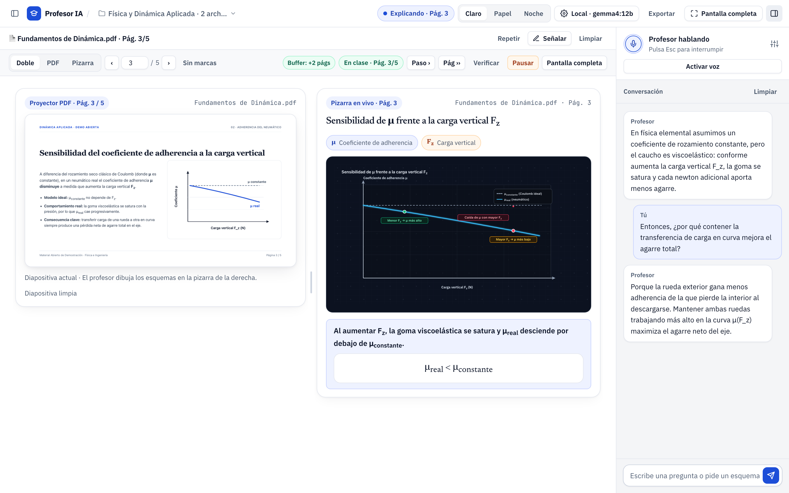
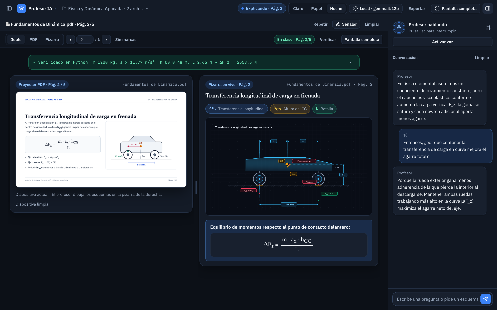
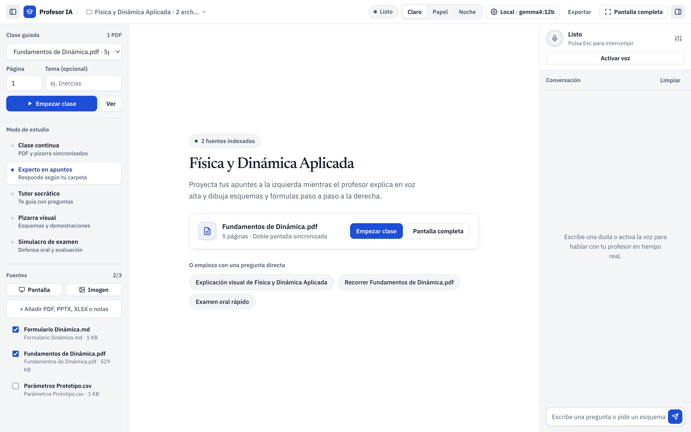
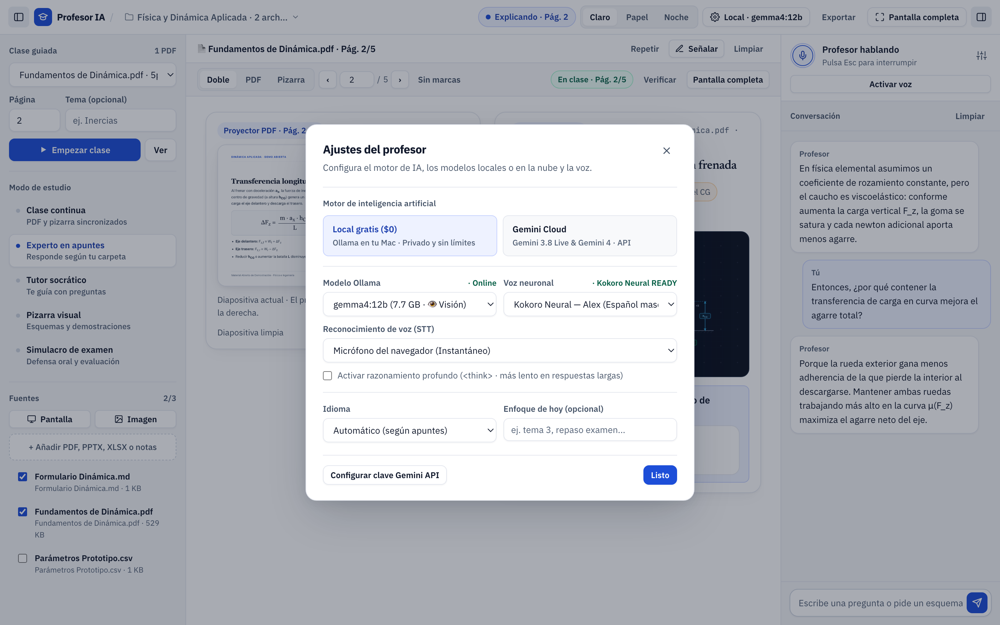
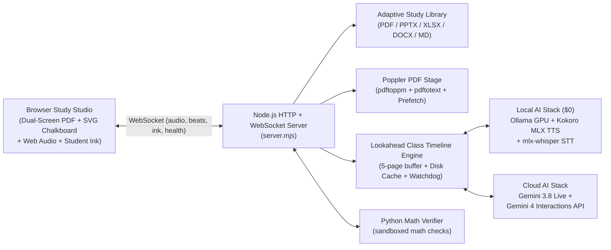

# Speaking AI Professor — Dual-Screen Live Classroom Stage

> **A real-time speaking AI tutor and interactive classroom studio** that projects your PDF slides on the left, draws synchronized stroke-by-stroke vector schematics and formulas on a live chalkboard on the right, verifies calculations in Python, optionally cross-checks facts online via a dedicated Web Research Agent without drifting from your notes, and listens to your voice interruptions — running **100% locally and free ($0)** on **macOS, Windows, and Linux** (**Ollama + Kokoro Neural TTS / Native OS Voice**) with a **1-click cloud switch** to **Google Gemini 3.8 Live & Gemini 4**.

[](#quick-start-2-minutes)
[](https://nodejs.org/)
[](https://ollama.com/)
[](https://ai.google.dev/)
[](#cognitive-ergonomic-study-ui)
[](./LICENSE)

[English Overview & Install](#quick-start-2-minutes) · [Architecture](#system-architecture) · [Apple Silicon $0 Setup](#apple-silicon-0-local-neural-studio) · [🇪🇸 Guía Rápida en Español](#-guía-rápida-en-español)



<details>
<summary>More screenshots: Noche Obsidian + Python Math Verifier · Welcome Studio · Dual Engine Settings</summary>







</details>

---

## Why I Built This

Most AI study tools dump walls of Markdown text into a chat box. Real engineering and science comprehension works differently: a great professor stands beside your slides, **speaks organically**, **draws progressive diagrams** while highlighting variables with consistent color coding, **verifies every number**, and lets you **interrupt mid-sentence or circle a formula** the instant something feels unclear.

**Speaking AI Professor** turns any folder of study materials (`PDF`, `PPTX`, `XLSX`, `DOCX`, `MD`, `HTML`) into a live, adaptive dual-screen classroom.

---

## Key Features & Engineering Highlights

### 1. Dual-Screen Live Classroom (`50% PDF Projector | 50% Precision Chalkboard`)
- **Synchronized Audio-Visual Timeline**: Voice narration, progressive SVG layer reveals, laser pointer callouts, and textbook equations stay strictly synchronized beat-by-beat.
- **Fullscreen 2-Screen Classroom (`F`)**: Hides all chrome, fits the PDF slide and live chalkboard side-by-side with a draggable splitter, and provides a floating live caption & quick-ask HUD.
- **Interactive Student Ink**: Toggle *Señalar / Dibujar*, circle any term or diagram on either the PDF or the chalkboard, and send the annotated frame straight to the vision model.
- **Standalone Offline Export**: Export all whiteboards, solved problems, quizzes, and transcripts into a single self-contained HTML study sheet.

### 2. Dual AI Engine — Local $0 (macOS · Windows · Linux) or Cloud (Gemini Live)
| Capability | 💻 Local Free ($0 · Default) | ☁️ Google Gemini Cloud (1-Click) |
| :--- | :--- | :--- |
| **Reasoning & Vision** | Ollama (`gemma4:12b`, `qwen3.5:9b`, `qwen3.5-27b`) on Metal / CUDA / CPU | Gemini 3.8 Live (`gemini-3.8-live`) & Gemini 4 Interactions API (`gemini-4-hydrogen` with auto failover to `gemini-3.5-flash-lite`) |
| **Voice Output (TTS)** | **Kokoro-82M** neural TTS (`mlx-audio` on Apple Silicon · `kokoro-onnx` on Windows/Linux) + zero-install OS native fallback (**macOS `say`**, **Windows SAPI**, **Linux `espeak-ng`**) | Native Gemini Live real-time bidirectional audio |
| **Voice Input (STT)** | Instant Browser Speech **or** 100% offline **Whisper** (`mlx-whisper` / `faster-whisper`, `Space` PTT) | Full-duplex VAD with Anti-Echo Shield |
| **Verified Web Research** | Optional checkbox: dedicated 4-phase Web Research Agent (authority tiers, SEO-farm filter, SSRF guard, zero-drift audit, clickable **Referencias web** panel) | Same dedicated 4-phase Web Research Agent + clickable **Referencias web** panel |

### 3. Domain-Adaptive 14-Template Parametric Chalkboard Engine
Instead of letting an LLM hallucinate misaligned raw SVG coordinates or off-topic diagrams, the chalkboard auto-detects the subject of each PDF and uses a deterministic parametric SVG engine (`public/blueprintTemplates.js`) featuring:
- **4 Universal Knowledge Templates** (used for literature, history, medicine, law, biology, economics, philosophy, CS, etc.): radial concept maps (`concept_map`), sequential timelines / cause-effect flows (`timeline_flow`), 2-column comparisons (`comparison`), and auto-scaled X-Y charts (`xy_graph`).
- **10 Physics & Engineering Templates** (auto-enabled only for matching STEM/automotive PDFs): free-body diagrams, 3D inertia & Steiner theorem, vehicle side/top/front views, 2-DOF quarter-car suspension, force & power balance, tire load sensitivity $\mu(F_z)$ & $F_y(F_z)$, Pacejka slip curve, and Kamm friction circle.
- **Automatic Bounding-Box Label Collision Avoider** (`createPlacer()`): guarantees zero overlapping badges or labels.
- **Unicode-Aware Math Compiler** (`public/stageRenderer.js`): renders clean typographic fractions, square roots, Greek symbols, and accented subscripts (e.g. `μ_teórico`, `F_tracción`) both in HTML and SVG `<tspan>`.

### 4. Reliability & Self-Healing Architecture
- **5-Layer Anti-Freeze Playback Watchdog**: Isolated timeline execution, `AudioContext.resume()` timeout guard, Web Audio `onended` failsafe timer, client-server 2.5s health heartbeat, and automatic queue recovery (`✓ Verificar`, `Siguiente paso [N]`, `Sig. pág [Shift+→]`).
- **Python Math Verifier** (`lib/mathVerifier.mjs`): Sandboxed local Python verification for numerical derivations with automatic variable capture.
- **Apple Silicon Unified Memory Hygiene**: Caps MLX scratch cache (`256 MB`) and configures Ollama (`OLLAMA_FLASH_ATTENTION=1`, `OLLAMA_KV_CACHE_TYPE=q8_0`) so LLM weights and neural TTS coexist smoothly in 24 GB Unified Memory without swap.

### 5. Cognitive-Ergonomic Study UI
Designed around **John Sweller's Cognitive Load Theory** and **Richard Mayer's Multimedia Learning Principles**:
- **3 Science-Backed Reading Themes**: **Papel cálido** (warm off-white default, zero glare), **Sepia** (minimal blue light for long sessions), and **Noche slate** (low-halation midnight slate — never pure `#000`), all mathematically verified to **WCAG AA/AAA** contrast (`13.9:1–15.8:1` body ink).
- **Physical Classroom Contrast**: The SVG drafting board remains a calm matte slate chalkboard across all 3 themes so vector curves stay razor-sharp beside warm paper notes.
- **Progressive Disclosure & Focus Mode**: One primary action card at top, collapsible drawers for advanced AI/library controls, and 1-click left/right sidebar collapse toggles.

---

## System Architecture



---

## Quick Start — 1-Click Desktop App (Recommended · Zero Terminal)

Download the standalone installer for your computer from [**GitHub Releases**](https://github.com/PedroRoigM/speaking-ai-professor/releases) — **no terminal, no Node.js, no Poppler, and no Python required**:

| Operating System | Download | What's Included |
| :--- | :--- | :--- |
| **macOS (Apple Silicon & Intel)** | `Speaking-AI-Professor-*-mac-arm64.dmg` / `x64.dmg` | Drag to Applications · Built-in PDF.js engine · Native macOS voice · Ollama $0 + Gemini Cloud |
| **Windows 10 / 11** | `Speaking-AI-Professor-*-Windows-Setup.exe` *(or Portable `.exe`)* | Standard installer + Start Menu shortcut · Built-in PDF.js engine · Native Windows SAPI voice · Ollama $0 + Gemini Cloud |
| **Linux** | `Speaking-AI-Professor-*-Linux-x64.AppImage` | Executable AppImage · Built-in PDF.js engine · Ollama $0 + Gemini Cloud |
| **Android (Phone & Tablet)** | `Speaking-AI-Professor-*-Android.apk` | Direct APK install · Built-in PDF.js + 14-template domain-adaptive chalkboard · Native Android TTS · **Gemini Cloud-only** (zero local models to protect phone battery & RAM) |

> **Zero-Terminal Local AI ($0) on First Launch**: On Windows, macOS, and Linux, if Ollama or a local model isn't ready yet, the desktop app opens a **1-click Auto-Setup modal** that detects your RAM, installs/starts Ollama automatically, and downloads the ideal free local model (`qwen2.5:3b` for 8 GB RAM, `qwen3.5:4b` for 16 GB RAM, `qwen3.5:9b` for 24+ GB RAM) with a live progress bar — no terminal needed! You can also switch to a free [**Gemini API Key**](https://aistudio.google.com/apikey) anytime.

### Build Desktop Installers Locally (Developers)

```bash
npm install
npm run desktop        # Run native Electron app in dev mode
npm run dist:mac       # Build macOS .dmg (dist/)
npm run dist:win       # Build Windows .exe Setup + Portable (dist/)
npm run dist:linux     # Build Linux .AppImage (dist/)
```

---

## CLI / Developer Install (2 Minutes)

### Prerequisites
- **Node.js 20+** ([nodejs.org](https://nodejs.org/))
- **Poppler** *(optional — built-in `pdfjs-dist` fallback works automatically if absent)*:
  - macOS: `brew install poppler`
  - Ubuntu / Debian: `sudo apt install poppler-utils`
  - Windows: `winget install oschwartz10612.Poppler`
- **Python 3.10+** *(optional — built-in JS math verifier fallback works automatically if absent; Python adds Office file extraction & Kokoro neural TTS)*
- **At least one AI backend**:
  - **Local Free ($0)**: [Ollama](https://ollama.com/) + `ollama pull gemma4:12b` *(or `qwen3.5:9b`)*
  - **Or Cloud**: a free/paid `GEMINI_API_KEY` from [Google AI Studio](https://aistudio.google.com/apikey)

### Option A — Universal 1-Command Setup (Windows · macOS · Linux)

Works identically in **Windows CMD / PowerShell**, **macOS Terminal**, and **Linux** (pure Node.js — zero `.ps1`/`.bat` ExecutionPolicy or antivirus issues):

```bash
git clone https://github.com/PedroRoigM/speaking-ai-professor.git
cd speaking-ai-professor

# Standard setup (Node deps + Poppler check + native OS voice + diagnostics):
npm run setup

# Or Full Studio setup (+ local Kokoro neural voice + global `professor` CLI):
npm run setup:all

# Launch with built-in sample notes:
npm start
```

> **macOS / Linux Shell Alternative**: `./install.sh` (or `./install.sh --all` on Apple Silicon M1–M4) is also available.

### Option B — Manual Install (macOS / Linux / Windows)

```bash
git clone https://github.com/PedroRoigM/speaking-ai-professor.git
cd speaking-ai-professor
npm install

# Optional: configure Gemini API key (or paste it inside Settings -> API Key)
cp .env.example .env

# Run built-in 9-point health & security verification
npm run verify

# Launch on http://localhost:3456
npm start
```

### Launch on ANY Course Folder

Run directly against any folder containing PDFs, slides, spreadsheets, or notes:

```bash
node server.mjs --dir "/path/to/your/course-folder" --open
```

Or link the global CLI once so you can type `professor` inside **any** folder:

```bash
npm link
cd /path/to/any/study-folder
professor
```

---

## Apple Silicon $0 Local Neural Studio

To get **unlimited, zero-cost, 100% private** classes with natural Spanish & English neural voice on macOS Apple Silicon:

1. **Install Ollama & pull a vision-capable model**:
   ```bash
   brew install ollama
   brew services start ollama
   ollama pull gemma4:12b      # Best balance: vision + STEM reasoning (~7.7 GB)
   # or: ollama pull qwen3.5:9b # Ultra-fast (~60 tok/s, vision)
   ```
2. **Optimize Ollama for Unified Memory & Metal GPU** (Flash Attention + `q8_0` KV-cache):
   ```bash
   bash scripts/optimize_mac_gpu.sh
   ```
3. **Install Kokoro-82M Neural TTS + mlx-whisper STT** (optional — macOS native voices work without this):
   ```bash
   brew install espeak-ng
   python3 -m venv .venv
   .venv/bin/pip install -r requirements-voice.txt
   ```
4. **Verify everything is green**:
   ```bash
   npm run verify
   ```

---

## Keyboard Shortcuts

| Shortcut | Action |
| :--- | :--- |
| `F` | Toggle **Fullscreen 2-Screen Classroom** (`PDF 50% \| Chalkboard 50%`) |
| `N` | Skip immediately to the next explanation beat / drawing layer |
| `Shift + →` / `Shift + ←` | Jump to next / previous PDF page |
| `Esc` | Interrupt professor immediately (or exit fullscreen) |
| `Space` *(hold)* | Push-to-Talk when using Offline Whisper or PTT mode |

---

## Project Structure

```text
speaking-ai-professor/
├── server.mjs                    # HTTP + WebSocket classroom server & session router
├── bin/professor.mjs             # Global CLI launcher (`professor`)
├── install.sh                    # One-command macOS/Linux installer
├── requirements-voice.txt        # Optional Apple Silicon MLX neural voice deps
├── lib/
│   ├── classTimeline.mjs         # Lookahead class engine, disk cache & self-heal watchdog
│   ├── classDirector.mjs         # Dual-screen session state & pacing coordinator
│   ├── pdfStage.mjs              # Parallel Poppler PDF renderer, OCR/text & prefetch
│   ├── studyLibrary.mjs          # Multi-format indexer (PDF/PPTX/XLSX/DOCX/MD/HTML)
│   ├── localProfessor.mjs        # Ollama Metal GPU client & model manager
│   ├── localVoice.mjs            # Node bridge for Kokoro-82M / mlx-whisper / macOS TTS
│   ├── voice_worker.py           # Persistent MLX GPU voice worker (256 MB cache cap)
│   ├── mathVerifier.mjs          # Sandboxed Python math verification engine
│   ├── professorConfig.mjs       # Gemini 3.8 Live / 4 configs & tool declarations
│   ├── professorSoulPrompt.mjs   # Organic pedagogical system instructions
│   └── visualCraftPrompt.mjs     # Diagram & visual clarity guidelines
├── public/
│   ├── index.html                # Progressive-disclosure study studio UI
│   ├── styles.css                # 3-theme WCAG AA/AAA cognitive-ergonomic stylesheet
│   ├── app.js                    # Web Audio engine, WebSocket client & dual-screen stage
│   ├── stageRenderer.js          # Unicode math compiler, PDF annotations & SVG animator
│   ├── blueprintTemplates.js     # 12 deterministic parametric SVG templates + collision avoider
│   └── pcm-processor.js          # Low-latency AudioWorklet microphone capture
├── scripts/
│   ├── verify_classroom.mjs      # 6-point automated diagnostic & self-heal test suite
│   ├── optimize_mac_gpu.sh       # Apple Silicon Ollama Metal / MLX tuning script
│   └── test-connection.mjs       # Live Gemini API connectivity check
└── examples/
    └── sample_study_notes.md     # Out-of-the-box sample notes to try immediately
```

---

## 🇪🇸 Guía Rápida en Español

**Profesor IA** convierte cualquier carpeta de apuntes (`PDF`, `PPTX`, `XLSX`, `DOCX`, `MD`) en un **aula interactiva de doble pantalla** con un profesor que habla contigo en tiempo real, dibuja esquemas precisos en la pizarra mientras proyecta tus diapositivas, verifica fórmulas con Python y te permite interrumpirle o rodear dudas sobre la pantalla.

### Características principales
- **Modo 100 % Local y Gratis ($0)** en Apple Silicon con **Ollama** (`gemma4:12b` / `qwen3.5:9b`) + voz neuronal **Kokoro-82M** + **mlx-whisper**, o cambio en 1 clic a **Gemini 3.8 Live / Gemini 4** en la nube.
- **Aula en Doble Pantalla (`F`)**: proyector PDF a la izquierda y pizarra paramétrica sin solapes a la derecha.
- **Estética ergonómica de estudio**: 3 temas pensados para reducir la fatiga visual (**Papel cálido** por defecto, **Sepia** sin luz azul y **Noche slate**), paneles laterales colapsables y divulgación progresiva.
- **Watchdog anti-bloqueos en 5 capas** y botón `Verificar` para que la clase nunca se quede parada.

### Instalación en 1 clic — App de Escritorio (Recomendado · Sin terminal)

Descarga el instalador para tu ordenador desde [**GitHub Releases**](https://github.com/PedroRoigM/speaking-ai-professor/releases) (no requiere instalar Node.js, Poppler ni Python):
- **macOS (Apple Silicon / Intel)**: abre el `.dmg` y arrastra **Speaking AI Professor** a *Aplicaciones*.
- **Windows 10 / 11**: ejecuta `Speaking-AI-Professor-*-Windows-Setup.exe` (o usa la versión `Portable.exe` sin instalar).
- **Linux**: ejecuta el `.AppImage`.
- **Android (móvil y tablet)**: descarga `Speaking-AI-Professor-*-Android.apk` e instálalo directamente (**100 % en la nube con Gemini Cloud**, sin modelos locales para no sobrecargar el teléfono).

Al abrir la app de ordenador por primera vez, si no tienes Ollama o ningún modelo descargado, aparece un **asistente automático en 1 clic** que detecta la RAM de tu PC, instala/arranca Ollama sin abrir terminal y descarga el modelo local gratuito ideal (`qwen2.5:3b` en 8 GB, `qwen3.5:4b` en 16 GB, `qwen3.5:9b` en 24+ GB). También puedes usar una **API Key gratuita de Google Gemini** en *Ajustes*.

### Instalación para desarrolladores / CLI (2 minutos)

```bash
git clone https://github.com/PedroRoigM/speaking-ai-professor.git
cd speaking-ai-professor

# Instalador universal multiplataforma (Windows · macOS · Linux):
npm run setup        # Estándar
npm run setup:all    # Completo (+ voz neuronal Kokoro + comando global `professor`)
ollama pull gemma4:12b
```

### Cómo usarlo en cualquier carpeta de estudios

```bash
# Probar ahora mismo con los apuntes de ejemplo:
npm start

# O abrir directamente sobre tu carpeta de la universidad:
node server.mjs --dir "/ruta/a/tu/carpeta-de-apuntes" --open

# Si instalaste con --link-cli o `npm link`, entra en cualquier carpeta y ejecuta:
professor
```

### Verificación del sistema
Antes o después de instalar, puedes comprobar que todo funciona al 100 % ejecutando:
```bash
npm run verify
```

---

## License

Released under the [MIT License](./LICENSE). Built by **Pedro Roig** (`@PedroRoigM`).
